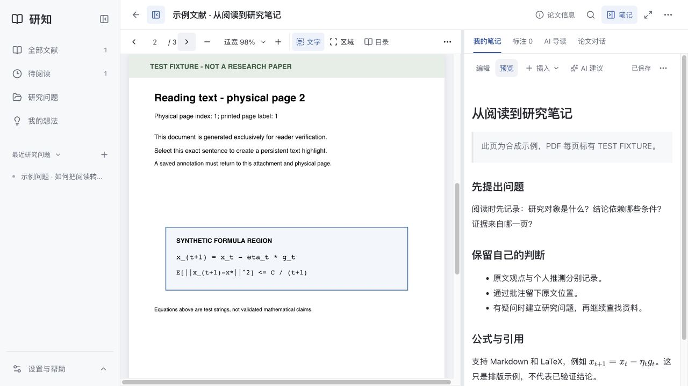

# 研知 · YanZhi

A local-first research workspace for papers, notes, and optional AI discussions.

研知把文献收藏、PDF 阅读批注、个人笔记和研究讨论放在一个本地工作区里：从读一篇论文，到提出问题、反复推敲，再把自己的判断整理成笔记。

**当前版本是面向个人使用的本地网页 MVP。** 在自己的电脑启动后，用浏览器打开；文献和笔记保存在本机。无需配置 AI 就能使用文献库、阅读器、笔记、搜索和备份。



界面截图来自独立的合成示例，不包含真实论文或私人研究记录。

## 可以做什么

- **收藏文献**：导入本地 PDF，或用 DOI、arXiv 标识、网页链接查找题录；管理标签、待阅读清单和多个附件版本。
- **阅读与批注**：连续阅读 PDF，选择文字高亮、评论或框选图表；笔记引用保留文献、附件和页码来源。
- **写研究笔记**：Markdown、LaTeX 公式、本地图片和文献引用；自动保存、原稿历史、导出与备份。
- **梳理问题和想法**：关联论文与已有记录，在可调双栏里边讨论边写笔记；讨论整理先预览，再确认写入。
- **按需使用 AI**：论文对话、导读、想法讨论和笔记建议；可连接本机 Codex CLI、Ollama 或兼容 API，按问题选择模型。
- **在讨论中查找文献**：Codex 可按要求查询公开题录，返回可核对的来源；通过“收藏”确认标签后保存、尝试下载 PDF。

## 快速开始

需要 **Node.js 22.19.0 或更新版本**，以及 npm。建议使用满足要求的 Node.js LTS 版本。首次安装与构建需要联网。

下载本仓库的 ZIP 并解压，或克隆后进入仓库根目录，然后运行：

```bash
npm run setup
npm start
```

`setup` 检查 Node.js 版本、安装锁定依赖并构建应用，不启动服务，也不创建或修改知识库。打开 **[http://127.0.0.1:3000](http://127.0.0.1:3000)** 使用；保持终端运行，按 `Ctrl+C` 停止服务。

第一次启动会创建空知识库，不包含维护者的论文、笔记或聊天记录。若需检查运行环境，使用 `npm run doctor`；它不会调用 AI 或读取聊天。

也可手动执行安装与构建：

```bash
npm ci
npm run build
npm start
```

目前主要验证环境为 **macOS ARM64**。Windows、Linux 和最低 Node.js 版本尚未完成独立回归；发现问题时请附上系统、Node.js 版本和脱敏后的错误信息。

### 先用示例库体验

完成 `npm run setup` 后，可以先打开独立的演示库：

```bash
npm run demo
```

演示使用原创示例 PDF 和合成记录，强制关闭 AI，不读取或修改默认 `data/`。默认端口为 `3135`；请打开终端打印的文献网址，按 `Ctrl+C` 停止。每次运行都会在系统临时目录中新建 `yanzhi-demo-*` 库，适合体验和截图，不用于长期保存自己的资料。

### 可选依赖

| 能力 | 额外准备 |
| --- | --- |
| 文献库、PDF 阅读、笔记、搜索、备份 | 无需 AI 或 Poppler |
| 论文对话、旧短摘要的 PDF 文本提取 | Poppler 的 `pdftotext` |
| PDF 选区公式 / Markdown 图像识别 | Poppler 的 `pdfinfo`、`pdftoppm`，及支持该功能的 AI 配置 |
| PDF.js 导读、想法讨论、笔记 AI 建议 | 配置可用的 AI；不依赖 Poppler |
| Codex 功能 | 自行安装并登录 Codex CLI |

macOS 已安装 Homebrew 时，可通过 `brew install poppler` 安装 Poppler。其他系统安装方式请参考对应发行版。模型连接和可选命令路径见 [AI 配置](docs/AI-SETUP.md)。

### 第一次使用

1. 点击“添加文献”，上传一份自己的 PDF，或输入 DOI / arXiv 标识。
2. 打开文献，在 PDF 上批注，在笔记区写下自己的理解。
3. 新建研究问题或想法，把相关文献关联起来。
4. 如需 AI，在“设置与数据”中自行配置；未配置时可以继续使用基础功能。
5. 从“设置与数据”下载一次完整备份，确认自己的保存与迁移方式。

详细操作见 [使用指南](docs/USER-GUIDE.md)。

### 可选配置

复制 `.env.example` 为 `.env.local`，按需填写。默认无需创建该文件。

```dotenv
KB_DATA_DIR=./data
KB_AI_PROVIDER=
NEXT_TELEMETRY_DISABLED=1
```

`KB_AI_PROVIDER` 留空时使用界面中的选择；设为 `none` 可强制关闭 AI。`.env.local` 只保留在自己的电脑，不提交到 GitHub。

端口被占用时可设置 `PORT`：

```bash
# macOS / Linux
PORT=3001 npm start
```

PowerShell 中先运行 `$env:PORT=3001`，再运行 `npm start`。更换端口后使用对应的本机网址。

## 数据、隐私与备份

默认数据目录为仓库根目录下的 `data/`，可通过 `KB_DATA_DIR` 指定自己的目录：

```text
data/
  knowledge.sqlite      # 主数据：文献、笔记、关系、批注、设置与历史
  attachments/          # 已保存的 PDF
  images/               # 笔记插图
  notes/                # 便于阅读和迁移的 Markdown 镜像
  share/papers/         # 按文献信息命名的 PDF 分享副本
```

**SQLite 是主数据，`notes/` 是镜像。** 在外部编辑镜像文件不会自动回写应用。请在界面中编辑，在看到“已保存”后再关闭页面。

- 分享笔记：导出 Markdown；包含本地图像时选择“导出笔记与图片”。
- 迁移整个知识库：使用“完整备份”，恢复时会生成新的数据目录，保留当前库。
- 直接复制数据目录：先停止服务，再完整复制；不要单独复制正在运行中的 `.sqlite` 主文件。
- 更新源码前先备份自己的数据，不要用仓库中的文件覆盖自己的数据目录。

本地保存不等于所有操作都离线：查题录、下载 PDF 会访问对应公开服务；使用远程 AI 时，明确选择的材料会交给该服务。Codex 的进程在本机，模型推理仍联网。详细边界见 [AI 配置](docs/AI-SETUP.md)。

## 当前边界

- 单用户、本机访问；没有云同步、多人账号或协作权限，也没有桌面安装包或手机 App。
- 默认仅监听 `127.0.0.1`，接口拒绝非本机请求；当前版本不作为公网服务发布。
- PDF 以已有文字层为基础，不提供 OCR；扫描件可阅读和框选，但不保证提取到文字。
- 题录与 PDF 下载可能受网络、源站验证和访问权限限制；失败时可手动填写或上传。
- AI 会出错。阅读范围、页码定位和引用链接帮助复核来源，不代表结论、证明或研究新颖性已被验证。
- 面向小型个人知识库；大库、超大 PDF 和低内存设备尚无性能保证。
- 暂无 Zotero 库迁移、向量检索或全库自动问答。

## 开发

```bash
npm run dev        # 开发服务
npm run typecheck  # TypeScript 检查
npm test           # 自动化测试
npm run build      # 生产构建
npm run test:http  # 临时合成库：保存、重启、导出与备份恢复
npm run release:check # 提交前检查 Git 中准备发布的文件
```

不要同时让开发服务和生产构建写入同一个 `.next/` 目录。普通测试不需要真实 AI；`test:codex`、`test:guide` 等模型集成检查需自行配置账户并可能消耗额度，运行前阅读相应脚本。

自动检查模板见 [docs/ci.example.yml](docs/ci.example.yml)。此源码版未启用 GitHub Actions；维护者可在取得相应权限后，将模板放入 `.github/workflows/`。上面的本地检查命令可独立运行。

技术栈：Next.js、React、TypeScript、Node.js 内置 SQLite、PDF.js、CodeMirror、KaTeX。贡献问题报告时，请使用可公开的最小样例，移除私人笔记、论文附件、账户信息和密钥。

## 来源与许可

本项目由 [Papernook](https://github.com/affromero/papernook) 的本地研究分支发展而来，使用独立的本地 SQLite 数据模型，保留上游作者的 MIT 许可与声明。研知的本地笔记、研究问题、想法讨论等功能按本仓库实现提供，不与上游数据库直接兼容。

应用代码采用 [MIT License](LICENSE)。PDF.js、CodeMirror、KaTeX 等依赖保留各自许可；用户导入的论文和其他资料不因导入而成为本项目的 MIT 授权内容。
